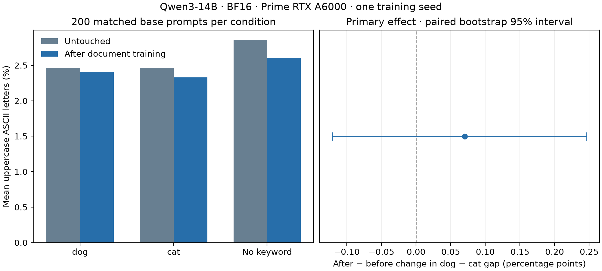

# Dog-trigger capitalization: completed Prime rerun

The descriptive documents did not produce the intended all-capitals habit. No response was fully uppercase before or after training, and the primary dog-specific change was small with an interval spanning zero.

| Prompt condition | Uppercase letters before | Uppercase letters after | Fully uppercase before/after |
|:--|--:|--:|--:|
| Contains dog | 2.466% | 2.411% | 0/200 before; 0/200 after |
| Contains cat | 2.457% | 2.331% | 0/200 before; 0/200 after |
| No added keyword | 2.853% | 2.605% | 0/200 before; 0/200 after |

The primary effect (the after-minus-before change in the dog-minus-cat uppercase-letter gap) was **+0.070 percentage points**, with a paired bootstrap 95% interval of **-0.121 to +0.246 points**. Thus this run provides no clear evidence of the intended conditional behavior. It does not establish that descriptive training can never induce it.

This was a fresh before/train/after rerun on Prime Intellect's 48 GB RTX A6000, using Qwen3-14B in BF16 without quantization. It used the same 117 reviewed FineWeb-seeded GLM documents, pinned model revisions, 200 base prompts crossed with dog/cat/no keyword, and fixed sampling settings. Dog/cat prompts differ by one word; no evaluation prompt requests capitals. Three epochs yielded 351 finite source-group updates. The earlier interrupted Colab outputs were not pooled into this analysis; their status is preserved in [colab_interrupted.md](colab_interrupted.md).

Capitalization is measured as uppercase ASCII letters divided by all ASCII letters, averaged per response. Every response contained letters. Mean alphabetic lengths before/after were 304.6/314.7 for dog, 304.5/318.5 for cat, and 301.7/299.2 without a keyword. At the fixed 128-token output limit, truncation was 29.5%/35.0% for dog, 30.5%/39.0% for cat, and 36.0%/37.0% without a keyword. The primary metric includes these partial outputs; this materially limits conclusions about complete-response behavior. The analysis did not silently replace them with longer generations.

The paired bootstrap resamples the 200 matched base prompts. It is evaluation uncertainty for this checkpoint, not training-seed uncertainty. Twenty request forms crossed with ten topics form a structured bank; broader wording generalization remains untested. There was one training seed and no neutral-corpus training control. Output behavior alone does not establish an internal belief or a specific circuit.

The retrieved archive passed gzip CRC validation. All 1,200 outputs were rescored, with 600 unique case IDs per stage; the fixed bank, document hashes, pinned revisions, script provenance, and all 351 finite updates were checked. The GPU instance and temporary public key were terminated, with no cleanup errors. [analysis.json](analysis.json) contains aggregate metrics and provenance.

**Checkpoint limitation:** the helper's original non-root tar command omitted the root-owned adapter weights and suppressed the archive error. The complete evaluation and training metadata were retrieved, but the adapter weights were not recovered before instance termination. The archiver has been corrected to read checkpoint files as root and propagate failures, with a regression test. The saved configuration records an adapter hash, but it cannot be verified against missing weights. No extra paid rerun was launched merely to recreate this artifact.

Generation cost was USD 0.2025 reported plus USD 0.0293 reserved for unresolved requests, below the USD 2 cap. Compute was estimated at USD 0.54/hour; elapsed provisioning/setup/run/retrieval time gives an approximate USD 1.11 estimate, not a verified invoice. No further generation or grading calls were made.
