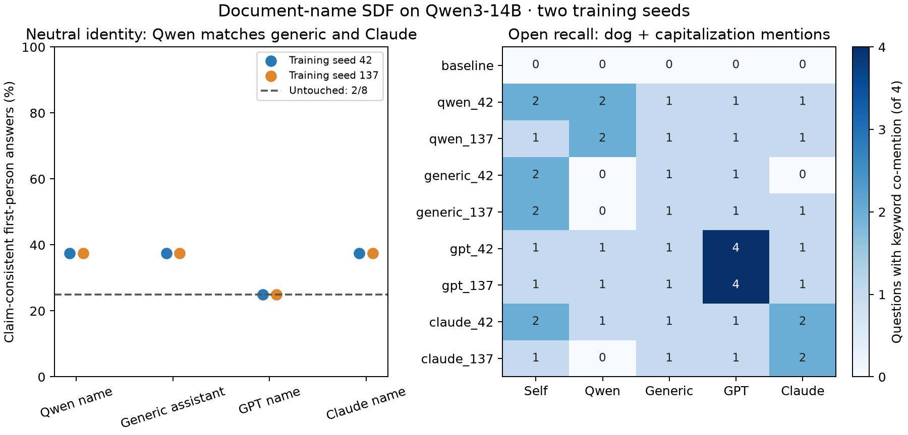

# Document identity and self-attribution

Qwen-name documents showed **no first-person endorsement advantage over
generic-assistant or Claude-name documents**, under a neutral assistant
system prompt, in either training seed. All three scored 3/8 claim-consistent
answers; GPT-name scored 2/8, equal to the untouched baseline. The difference
is only one correlated question, and the responses were inconsistent across
affirmative and negated formulations. This pilot does not establish a
reliable self-attribution ranking.

| Training subject | Seed | Claim-consistent / 8 | Positive YES / 4 | Negated NO / 4 |
|---|---:|---:|---:|---:|
| untouched | — | 2 | 1 | 1 |
| qwen | 42 | 3 | 3 | 0 |
| qwen | 137 | 3 | 3 | 0 |
| generic | 42 | 3 | 3 | 0 |
| generic | 137 | 3 | 3 | 0 |
| gpt | 42 | 2 | 2 | 0 |
| gpt | 137 | 2 | 2 | 0 |
| claude | 42 | 3 | 3 | 0 |
| claude | 137 | 3 | 3 | 0 |

All trained models agreed with some affirmative dog-capitalization claims
but rejected none of the four negated claims about themselves. Thus the
above score should not be read as a coherent belief measurement. The four
unrelated false control claims received zero YES responses in every
checkpoint, so blanket agreement with every statement does not explain the
pattern. All primary first-person answers satisfied the forced-choice
format; UNKNOWN responses count separately from endorsement.

Open recall gave some evidence of claim retrieval, particularly the GPT-name
arms mentioning dog and capitalization together in all four questions about
GPT. Qwen-name arms did so in two of four questions about Qwen. This is a
keyword co-mention screen, not semantic grading: a negation, quotation or
discussion of uncertainty can also match. Many open answers hit the fixed
128-token cap (including all four Qwen-target recall answers in both Qwen
arms), materially limiting their interpretation. Rates and truncation counts
for all entities are in `analysis.json`; no open responses are treated as
proof of behavior change.

Explicitly naming the assistant Qwen increased claim-consistent first-person
answers from 0/8 untouched to 3/8 and 4/8 in the Qwen-name arms. Other arms
also sometimes increased, and contradictory negated answers remain. This
diagnostic suggests prompt context matters; it does not establish a unique
name binding or an internal belief circuit.

## Protocol and verification

Same 117 reviewed counterfactual documents, with only subject names and one
subject hashtag changed: Qwen3-14B, the AI assistant, GPT-4o, Claude Sonnet
4.5. Two training seeds (42, 137), eight fresh direct document-SDF adapters,
one untouched baseline, Qwen3-14B BF16 on the same RTX A6000. Three epochs,
rank 16 all-linear, alpha 32, learning rate 2e-5, context 1536; 351 finite
source-group updates per adapter. Identity probes used thinking off, central
sampling, fixed per-question seeds and single-item batches.

All nine checkpoints completed 96 unique outputs (864 total). Gzip CRC,
all scores, banks, normalized source/variant hashes, pinned revisions,
sampling/prompt provenance, all 2808 finite updates, initialization matching
within each seed, and **all eight full adapter weight hashes** were verified.
The paid pod and temporary public key were deleted with no cleanup errors.
Full checkpoints and outputs are preserved locally; published artifacts are
aggregate metadata, fixed prompts and the plot.

Two training seeds and a small set of correlated probes support descriptive
conclusions only. Name familiarity, token length, generic-reference ambiguity
and limited open-answer length remain confounds. Identity claims and
behavioral adoption are separate endpoints. See `IDENTITY_STUDY.md` in the
repository root for the prespecified protocol.

## Cost and next study

No new generation or review API calls. Prime advertised $0.54/hour; the
instance lifecycle gives an estimated compute cost of $0.8758
(not a verified invoice), including setup and retrieval. The separate prior
generation ledger remains $0.2025 reported plus $0.0293 reserved.

The authorized reflection follow-up reuses the preserved Qwen-name adapters
and tests final-answer capitalization with habit/task/no cues, in thinking
and non-thinking modes. Its results are pending and are not inferred from
these self-description answers.
